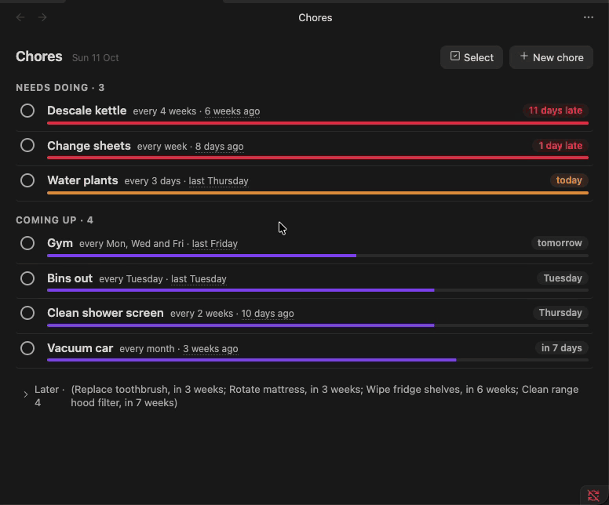
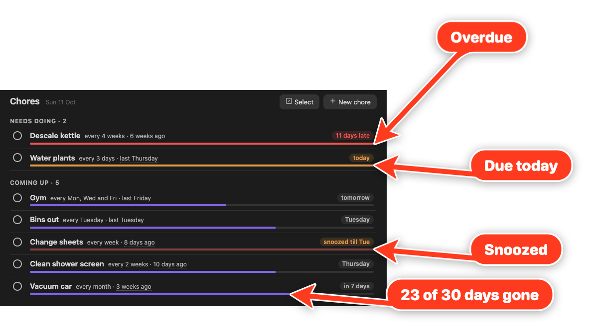
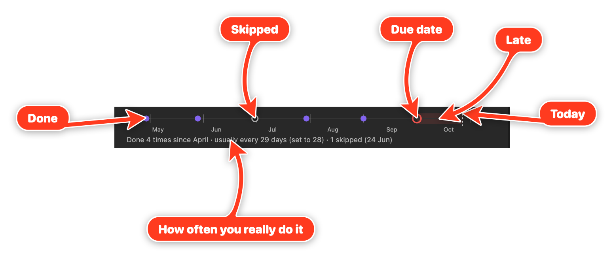

Choreday is a chore tracker for Obsidian. Each recurring household chore is a note in your vault that says how often it should be done and when it was last done. Choreday reads those notes and shows what needs doing and what's coming up, with each chore's history over the last few months.

Chores don't fit a task manager. They have no deadline and never finish, and the question you usually ask about one is 'when did I last do this?'. Descaling the kettle or cleaning the range hood filter comes around every few months, and without a record it's easy to be out by a factor of three.

Everything Choreday knows is in each chore note's frontmatter. If you uninstall it tomorrow, your chores and their history are still plain text that Properties, Bases and Dataview can read.



## Install


Choreday is not in Obsidian's community plugin directory yet. For now, install it with [BRAT](https://github.com/TfTHacker/obsidian42-brat):

1. Install and enable BRAT from Obsidian's community plugins.
2. Run `BRAT: Add a beta plugin for testing` and enter `https://github.com/paulchiu/obsidian-choreday`.
3. Enable Choreday from the community plugins list.

Turn on "Auto-update plugins at startup" in BRAT's settings to pick up new releases automatically. For a manual install from a GitHub release, see [Install](docs/install.md).

## Add your first chore


1. Run `New chore` from the command palette, or select New chore in the Chores view.
2. Give it a name and an interval, for example `Descale kettle` every 4 weeks.
3. Save. Choreday creates `Chores/Descale kettle.md`, and the chore shows under Needs doing, since it has never been done.

Run `Open chores` (or select the ribbon icon) to open the Chores view. Tick the circle beside a chore when you do it. The row is struck through for a moment with an Undo toast, then moves to wherever its next due date puts it.

## The Chores view


Chores sit in three groups. Needs doing holds the chores due today or overdue, most urgent first (see [The urgency bar](#the-urgency-bar)). Coming up holds the chores due in the next two weeks, plus anything snoozed. Later holds the rest, collapsed to a one-line summary until you open it.

### The urgency bar



The bar under each chore fills up as the chore comes due. It's empty on the day you do the chore and full once the interval has passed. Its fill is the chore's urgency, capped at full:

$$\text{urgency} = \frac{\text{today} - \text{last done}}{\text{interval in days}} \qquad \text{fill} = \min(\text{urgency},\ 1)$$

Vacuum car, for example, is done every month and was last done 23 days ago, so its urgency is $23 / 30.44 \approx 0.76$ and its bar is three quarters full. A week counts as 7 days, a month as 30.44 and a year as 365.25. A skip counts as the last time it was done, since it starts the next cycle.

The colour shows where the chore stands:

- The theme's accent colour (purple by default) before the due date.
- Amber on the due date.
- Red once it's overdue, and for a chore that has never been done.
- Faded while it's snoozed, in whichever colour it would otherwise have.

Needs doing is sorted by urgency without the cap. 3 days late on a weekly chore is $10 / 7 \approx 1.43$, and 3 days late on a yearly one is $368 / 365.25 \approx 1.01$, so the weekly chore comes first. A chore that has never been done goes to the top.

A chore on set days (`anchor: calendar`) measures urgency from its due date instead, in steps of the average gap between its days:

$$\text{urgency} = 1 + \frac{\text{today} - \text{due date}}{\text{interval in days} \div \text{days in the schedule}}$$

Gym on Monday, Wednesday and Friday has an average gap of $7 / 3 \approx 2.33$ days, so on a Sunday, with Friday done and Monday next, its urgency is $1 - 1 / 2.33 \approx 0.57$.

### History

Select a row to expand its history strip, which covers about the last six intervals (or three weeks for a chore on several days a week).



Each completion is a dot and each skip a hollow dot. The ring marks the due date, amber until it passes and red after, with the late stretch shaded up to today's dotted line. The faint ticks mark each interval, counted back from the due date, so a dot close to its tick was done on time. For a chore on set days, a missed day shows as a dashed red circle.

The line underneath compares how often you do the chore with the interval you set (for example, 'usually every 29 days (set to 28)'). Hover a dot for its date; select it to remove an entry logged by mistake.

### Row menu

Right-click a row (long-press on mobile) for its menu:

- Done today, Done yesterday, or Done on a date you pick.
- Snooze until tomorrow, a preset scaled to the chore's interval, next weekend, or a date you pick. A snoozed chore sits in Coming up until the snooze ends.
- Skip this time, which starts the next cycle without recording a fake completion.
- Edit the name, interval or schedule, with a preview of how the change moves the next due date.
- Open the chore's note.
- Select, to pick several chores and snooze or skip them together.

To snooze or skip several chores at once, select Select at the top of the view, or Select in a row's menu. Selecting a row then picks it instead of opening its history, and Select all on a group heading picks the whole group. Snooze offers tomorrow, next weekend, the interval-scaled preset when every picked chore shares it, or a date you pick; Skip skips each one this time. One toast covers them all, with a single Undo.

After the toast has gone, Undo last change steps back through your last 20 ticks, snoozes, skips and removed history entries, newest first. It's in the view's more options menu (⋮) and the command palette, and Mod+Z runs it while the Chores view has focus. The list lasts until Obsidian restarts, and doesn't cover edits or new chores.

## Chore notes


A chore note looks like this:

```markdown
---
type: chore
every: 4w # <n><d|w|m|y>
anchor: done # done (default) or calendar, with days: [tuesday]
keep: 6 # optional per-chore history limit
early: false # optional, overrides the Early ticks count setting
snoozed_until: 2026-10-24
done: # newest first
  - 2026-09-02
  - 2026-08-01
skipped:
  - 2026-07-20
---

Citric acid, 2 tbsp in a full kettle. Boil, leave 30 min, rinse twice.
```

Only `type: chore` and `every` are required. The note's name is the chore's name, and the body is yours; Choreday never writes to it.

`anchor: done` counts the next due date from the last time you did the chore. For chores tied to the calendar, use `anchor: calendar` with a `days` list and an interval in weeks:

- Bins every Tuesday: `every: 1w`, `days: [tuesday]`.
- Gym on Monday, Wednesday and Friday: `every: 1w`, `days: [monday, wednesday, friday]`.
- Every second week on Monday and Thursday: `every: 2w`, `days: [monday, thursday]`. Weeks start on Monday, and the weeks that count are the ones most of your ticks on those days fell in, so one late tick in an off week doesn't move them.

Three-letter names (`mon`) work too, and an older `day: tuesday` is still read. After missed days, the latest one is due and the earlier ones show as missed on the strip, so one tick clears them. With the Early ticks count setting on, a tick before the next scheduled day counts for it: taking the bins out on Monday night covers Tuesday.

Hand edits are as valid as edits from the view. When Choreday writes, it changes only the lines for the keys that changed, so comments and your own formatting in the frontmatter survive. A value it can't read is flagged on the row for you to fix, and a note without a readable `every` is listed under Needs fixing at the bottom of the view.

Choreday works out last done, next due and how late a chore is from these dates each time it draws the view, and doesn't store them.

## Show a chore in its note


Add an empty `choreday` code block to a chore note to show that chore's row with its history strip, so you can tick it off from the note itself:

````markdown
```choreday

```
````

To show a different chore, name it:

````markdown
```choreday
chore: Descale kettle
```
````

## Settings

- Chores folder: notes with `type: chore` in this folder and its subfolders are chores. Defaults to `Chores`.
- History to keep: completions kept per chore (default 12). Older ones are trimmed the next time Choreday writes to that note. A chore note can override it with `keep`.
- Early ticks count: for chores on set days, a tick before the next scheduled day counts for that day (default on). Turn it off to count only ticks on or after it. A chore note can override it with `early: true` or `early: false`.

## Limitations

- No reminders or notifications outside Obsidian.
- History is deliberately short (a dozen entries by default), so questions like 'how often did I do this in 2025?' are out of scope.
- No per-completion notes or who-did-it; an occasional remark belongs in the note body.
- Changing a chore's interval is not recorded; the history strip redraws at the new interval.
- Calendar chores repeat in weeks only (every Tuesday, weekdays, every second Sunday). Monthly calendar dates such as 'the 1st of each month' are not supported.
- Long-press for the row menu has only been checked in Obsidian's mobile emulation so far, not on a phone.

## Development

See [CONTRIBUTING.md](CONTRIBUTING.md) for how to propose changes and what a good PR looks like.

Run `npm install` to install dependencies, then `npm run dev` to start esbuild in watch mode. It produces `main.js` next to `manifest.json` at the repo root.

To point a dev vault at the build, symlink `main.js`, `manifest.json`, and `styles.css` from the repo root into `<vault>/.obsidian/plugins/choreday/`. Reload Obsidian, or toggle the plugin off and on, to pick up new builds.

The local gate is `npm test`, `npm run lint`, and `npm run format`. Run all three before pushing.

On merge to `main`, the Release workflow stamps a version using the PR's label (`major`, `minor`, `patch`, or `norelease`) and publishes a GitHub release with `main.js`, `manifest.json`, and `styles.css` attached. That release is what BRAT installs.

See `AGENTS.md` for project conventions.

## License

MIT.
