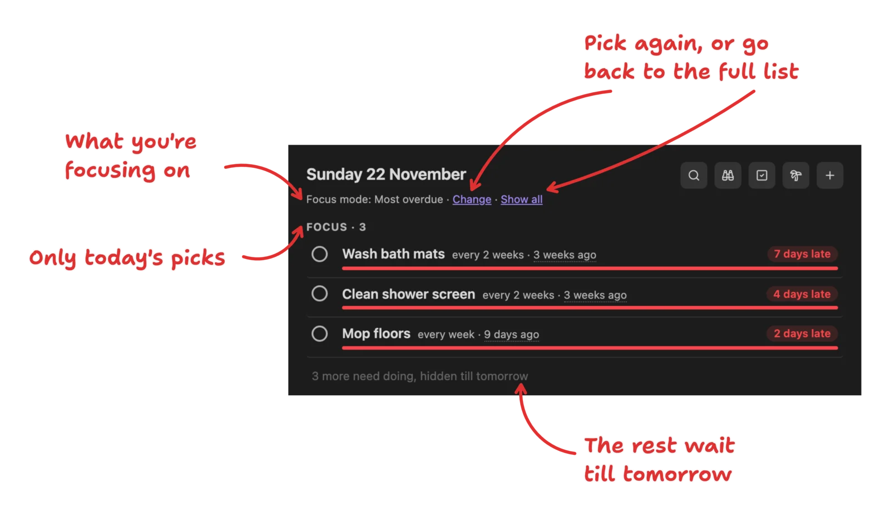
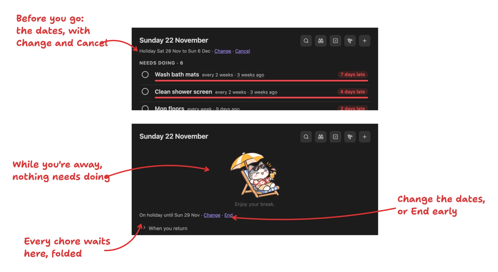
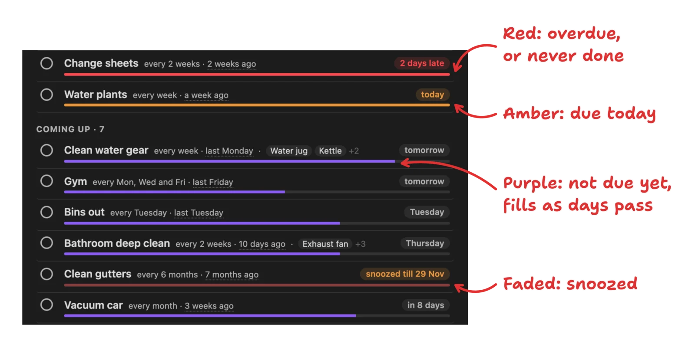
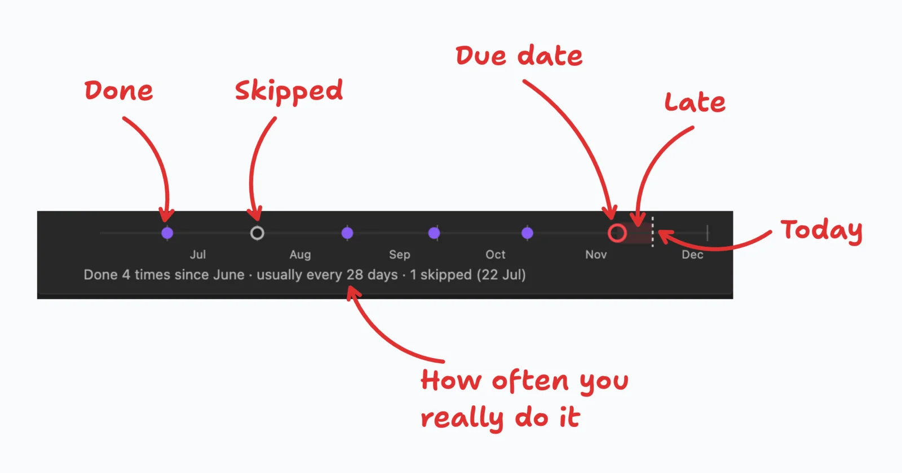
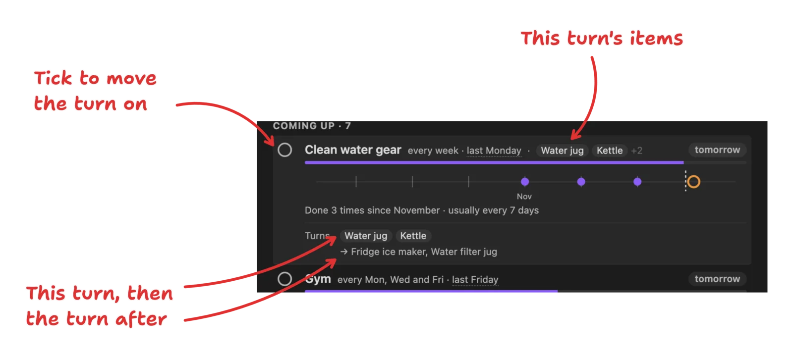

# Choreday

Household chores do not fit well in a normal task manager. They have no hard deadline and they never finish repeating. I made Choreday because what I want to know is when a chore was last done, so I can tell whether it needs doing again. Jobs like descaling the kettle or cleaning the range hood filter need doing every few months, and doing them more often than that does not gain you much.

In Choreday, each recurring chore is a dedicated note in your vault. The note records how often the chore should be done and the dates it was completed. The Chores view reads those notes and gives you a list to review what is due, see what is coming up, check a chore's history over the last few months, and tick jobs off as you do them. When the full list feels too long, Focus mode shows a few chores for today and hides the rest, and holiday dates pause your schedules while you are away.

Everything Choreday tracks lives in standard frontmatter properties on each chore note. There is no separate database. Even without the plugin, your chores and completion history stay readable as Obsidian Properties, in Bases, and in Dataview.


## Install


Choreday is in Obsidian's [community plugin directory](https://community.obsidian.md/plugins/choreday). To install it:

1. In Obsidian, open Settings, then Community plugins, and turn on community plugins if they are off.
2. Select Browse, search for "Choreday", then select Install and Enable.

Obsidian picks up new releases when you select "Check for updates" under Community plugins. For a manual install from a GitHub release, or to move an existing install across from BRAT, see [Install](docs/install.md).

## Add your first chore


1. Run `New chore` from the command palette, or select New (the plus button) in the Chores view.
2. Give the chore a name and an interval, for example 'Descale kettle' every 4 weeks.
3. Save. Choreday creates `Chores/Descale kettle.md` in your vault. Because the chore has never been done, it appears under Needs doing.

Run `Open chores` from the command palette (or select the ribbon icon) to open the Chores view. Tick the circle beside a chore when you do it. The row is struck through briefly while an Undo toast appears, and then the chore moves to its new place based on its next due date.

## The Chores view


The Chores view organises your chores into three groups:

1. Needs doing holds chores due today or overdue, with the most urgent first (see [The urgency bar](#the-urgency-bar)).
2. Coming up holds chores due in the next two weeks, along with anything snoozed.
3. Later holds the rest and stays collapsed to a one-line summary until you open it.

Today's date sits at the top of the view. The buttons beside it are Search, Focus mode, Select, Plan a holiday, and New. Hover over a button on desktop, or long-press it on mobile, to see its name.


### Focus mode

When the Needs doing list gets long, Focus mode shows a few chores for today and hides the rest until tomorrow. You choose how to pick them and how many to show (up to 5), and the form previews the chores it will include:

- Most overdue follows the Needs doing order.
- Most recently done puts the chores you completed most recently first.
- Done most often puts the chores with the shortest average gap between completions first, which tend to be the quickest jobs.
- Surprise me picks at random. Select Again to reshuffle.

The view then lists those chores under Focus, along with a count of the other chores that still need doing. Coming up and Later stay hidden. The line under today's date names what you are focusing on, with Change to choose again and Show all to return to the full list. Focus mode lasts until the date rolls over. It survives closing the view, reloading the plugin, and restarting Obsidian. It is kept on each device locally and does not sync, so your phone and your computer can each focus on different chores.



Turn on Every morning in the form to save your choice so each new day opens in Focus mode. Turn it off in the same form to go back to the full list each morning.

Turn on No pressure to keep Focus mode calm. The chores you are focusing on leave out how late they are and when they were last done, and the count of other chores goes away. Search and Show all still show everything. No pressure is saved for next time.

### Holiday

Before a trip, select Plan a holiday (the palm tree button) at the top of the Chores view, or run `Plan a holiday` from the command palette, and pick your first and last days away. On a phone, where the top bar has less room, Plan a holiday is in the view's more options menu (⋮). Holiday days do not count towards any chore. The clock stands still while you are gone, so your chores come back spread out as they were when you left and do not all fall due on the day you get home:

- A chore that would have fallen due on the third day away falls due on the third day back, and one due after the holiday moves out by the length of the trip.
- A chore that was already late when you left is no later when you return.
- A chore on set calendar days skips the days that fall during the holiday without counting them as missed, and is next due on its first scheduled day back, even if you missed a scheduled day just before you left.

While a holiday is under way, the cat wishes you a good break and nothing needs doing. Every chore waits under When you return, which stays folded without chore names or a count until you open it. While a holiday is planned or under way, a line under the date shows when it runs, with Change to pick other dates and End (or Cancel, before it starts) to stop it. Ending a holiday early starts the clock again from today. The holiday dates live in the plugin's settings, so they sync along with your settings and no chore notes change.



### Search

Search filters every chore by name, including chores in Later and anything hidden by Focus mode, and shows the matches in one list with each chore's group beside it. Select the cross in the search box to clear it, or press Escape (or select Search again) to close it.

### The urgency bar



The bar under each chore fills as the due date gets closer. It is empty on the day you do the chore and full once the interval has passed. The fill shows the chore's urgency, capped at full. The formula is:

$$\text{urgency} = \frac{\text{today} - \text{last done}}{\text{interval in days}} \qquad \text{fill} = \min(\text{urgency},\ 1)$$

For example, if 'Vacuum car' is done every month and was last done 23 days ago, its urgency is $23 / 30.44 \approx 0.76$ and its bar is three quarters full. A week counts as 7 days, a month as 30.44, and a year as 365.25. A skip counts as the last time the chore was done, because it starts the next cycle from that date.

The colour of the bar shows where the chore stands:

- Your theme's accent colour (purple by default) before the due date.
- Amber on the due date.
- Red once it is overdue, and for a chore that has never been done.
- Faded while it is snoozed, in whichever colour it would otherwise have.

Needs doing is sorted by urgency without the cap. Being three days late on a weekly chore gives an urgency of $10 / 7 \approx 1.43$. Being three days late on a yearly chore gives $368 / 365.25 \approx 1.01$, so the weekly chore comes first. A chore that has never been done goes to the top.

A chore on set calendar days (`anchor: calendar`) measures urgency from its due date instead, in steps of the average gap between its scheduled days:

$$\text{urgency} = 1 + \frac{\text{today} - \text{due date}}{\text{interval in days} \div \text{days in the schedule}}$$

'Gym' on Monday, Wednesday, and Friday has an average gap of $7 / 3 \approx 2.33$ days. On a Sunday, with Friday done and Monday next, its urgency is $1 - 1 / 2.33 \approx 0.57$.

### History

Select a row to expand its history strip. The strip covers about the last six intervals, or three weeks for a chore scheduled on several days a week.



Each completion is a solid dot; each skip is a hollow dot. A ring marks the due date; it is amber until the date passes and red once it is overdue. The late stretch is shaded up to today's dotted line. Faint ticks mark each interval counted back from the due date, so a dot close to its tick was done on time. For a chore on set calendar days, a missed day appears as a dashed red circle.

The summary line underneath compares how often you do the chore with the interval you set, for example 'usually every 29 days (set to 28)'. Hover over a dot to see its date, or select it to remove an entry logged by mistake.

### Row menu

Right-click a row on desktop, or long-press it on mobile, to open its menu:

- Done today, Done yesterday, or Done on a date you pick.
- Snooze until tomorrow, to a preset scaled to the chore's interval, to next weekend, or to a date you pick. A snoozed chore sits in Coming up until the snooze ends.
- Skip this time, which starts the next cycle without recording a false completion.
- Edit the name, interval, or schedule. The form previews how the change moves the next due date.
- Open the chore's note.
- Select, to pick several chores and snooze or skip them together.

To snooze or skip several chores at once, select Select (the tick box button) at the top of the view, or Select in a row's menu. While selection mode is active, selecting a row picks it instead of opening its history strip, and Select all on a group heading picks the whole group. Snooze offers tomorrow, next weekend, the interval-scaled preset when every picked chore shares it, or a date you pick; Skip skips each selected chore this time.

After the Undo toast disappears, Undo last change lets you step back through your 20 most recent ticks, snoozes, skips, and removed history entries, newest first. It is in the view's more options menu (⋮) and the command palette, or you can press Mod+Z while the Chores view has focus. The undo list lasts until Obsidian restarts and does not cover edits or new chores.

## Chore notes


A chore note looks like this:

```markdown
---
type: chore
every: 4w # <n><d|w|m|y>
anchor: done # done (default) or calendar, with days: [tuesday]
keep: 6 # optional per-chore history limit
early: false # optional, overrides the Early ticks count setting
snoozed_until: 2026-10-24
done: # newest first
  - 2026-09-02
  - 2026-08-01
skipped:
  - 2026-07-20
---

Citric acid, 2 tbsp in a full kettle. Boil, leave 30 min, rinse twice.
```

Only `type: chore` and `every` are required. The note name is the chore name, and the body of the note is free text for instructions or anything else you want to keep with the chore. Choreday never writes to the note body.

By default, `anchor: done` counts the next due date from the last time you did the chore. For chores tied to the calendar, use `anchor: calendar` with a `days` list and an interval in weeks:

- Bins every Tuesday: `every: 1w`, `days: [tuesday]`.
- Gym on Monday, Wednesday, and Friday: `every: 1w`, `days: [monday, wednesday, friday]`.
- Every second week on Monday and Thursday: `every: 2w`, `days: [monday, thursday]`. Weeks start on Monday, and weeks are loosely counted so you can tick a little late or early and still get completion credit for that turn.

Three-letter day names (`mon`) work too, and Choreday still reads the older `day: tuesday` property as `days: [tuesday]`. Without an `anchor`, adding either `days` or `day` puts the chore on set calendar days. After missed days, only the latest one is due and earlier ones appear as missed on the history strip, so one tick clears them. With Early ticks count turned on, a tick before the next scheduled day counts for that day: taking the bins out on Monday night covers Tuesday.

You can edit chore notes by hand or in the view. When Choreday writes to a note, it changes only the lines for keys that changed, so your YAML comments and frontmatter formatting survive. Choreday flags unreadable values on the row for you to fix. A note without a readable `every` appears under Needs fixing at the bottom of the view.

Choreday works out last done, next due, and how late a chore is from these dates each time it draws the view. It does not store those derived values in the note.

### Rotating chores

Some chores are a set of small jobs you take turns at. A `rotate` list makes one chore note step through them:

```yaml
type: chore
every: 1w
rotate:
  - Fridge ice maker
  - Water filter jug
  - Water jug
  - Kettle
per_turn: 2 # optional, default 1
turn: Water jug # first item of this turn, written by Choreday
```



The row shows this turn's items under the chore's name, with the next turn on a line beneath. Ticking the chore (or marking it done yesterday or on a date) records the date in `done` and moves `turn` to the item after the last one done. When it reaches the end of the list, it wraps back to the top. Skip this time keeps the same turn so the skipped items come up next time, and Undo puts `turn` back along with `done`.

Because `turn` names an item instead of a list position, reordering the list or adding an item keeps your place. Without a `turn`, or with one naming an item no longer in the list, the turn starts at the top. A `per_turn` larger than the list does the whole list each time. In the New chore and Edit forms, turn on Rotate through a list to show Per turn and Items. The form lists the items with buttons to move and remove each one, marks the item this turn starts at, and adds new items from a field under the list (pasting several lines adds one item per line). Removing the item this turn starts at moves the turn on to the next item. Saving with the switch off, or with no items, saves an ordinary chore and removes the note's `rotate`, `per_turn`, and `turn` keys.

## Show a chore in its note


Add an empty `choreday` code block to a chore note to show that chore's row and history strip inside the note. You can then tick it off from the note itself:

````markdown
```choreday

```
````

To show a different chore in any note, name it with `chore`:

````markdown
```choreday
chore: Descale kettle
```
````

When two chores share a name in different folders, the block lists them instead of guessing. Add the folder path to pick one, for example `chore: Kitchen/Clean`.

## Settings

- Chores folder: notes with `type: chore` in this folder and its subfolders are chores. Defaults to `Chores`.
- History to keep: completions kept per chore (default 12). Older ones are trimmed the next time Choreday writes to that note. A chore note can override it with `keep`.
- Early ticks count: for chores on set calendar days, a tick before the next scheduled day counts for that day (default on). Turn it off to count only ticks on or after the scheduled day. A chore note can override it with `early: true` or `early: false`.

## Limitations

- No reminders or notifications outside Obsidian.
- History is kept short on purpose (a dozen entries by default), so questions like 'how often did I do this in 2025?' are out of scope.
- No per-completion notes or record of who did it; an occasional remark belongs in the note body.
- Changing a chore's interval is not recorded; the history strip redraws at the new interval.
- Calendar chores repeat in weeks only (every Tuesday, weekdays, every second Sunday). Monthly calendar dates such as 'the 1st of each month' are not supported.
- Long-press for the row menu has only been checked in Obsidian's mobile emulation so far, not on a phone.

## Development

See [CONTRIBUTING.md](CONTRIBUTING.md) for how to propose changes and what a good pull request looks like.

Run `npm install` to install dependencies, then `npm run dev` to start esbuild in watch mode. It produces `main.js` next to `manifest.json` at the repo root.

To point a dev vault at the build, symlink `main.js`, `manifest.json`, and `styles.css` from the repo root into `<vault>/.obsidian/plugins/choreday/`. Reload Obsidian, or toggle the plugin off and on, to pick up new builds.

Before pushing, run `npm test`, `npm run lint`, and `npm run format`.

On merge to `main`, the Release workflow stamps a version using the pull request's label (`major`, `minor`, `patch`, or `norelease`) and publishes a GitHub release with `main.js`, `manifest.json`, and `styles.css` attached. Obsidian's community plugin directory installs and updates Choreday from these releases.

See [AGENTS.md](AGENTS.md) for project conventions.

## Licence

MIT.
